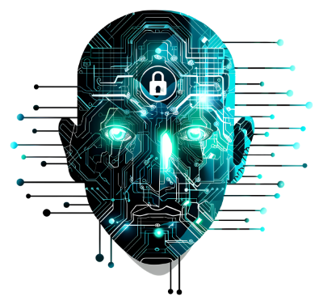
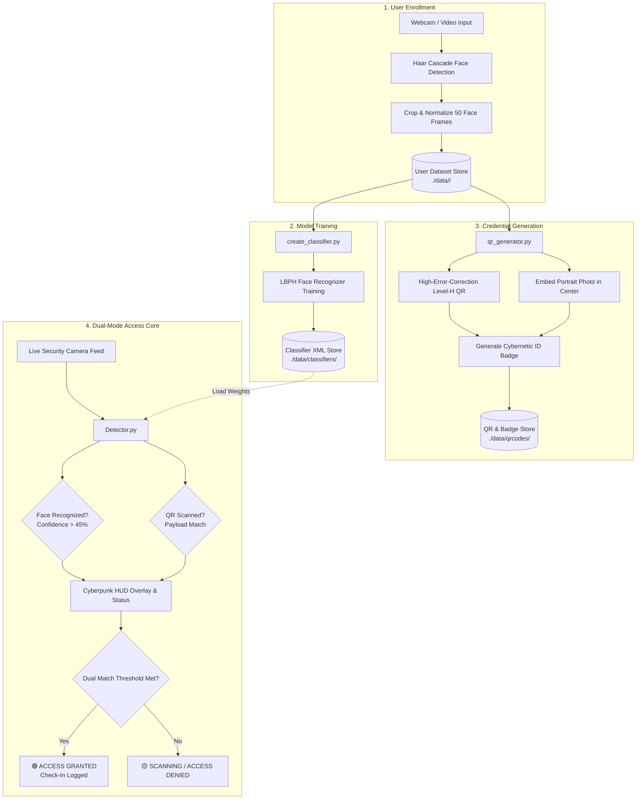

# ⚡ HARIS - High-Accuracy Recognition & Identity System

<div align="center">



### **AI-Powered Dual Biometric Facial Recognition & Photo-Embedded QR Access Control Suite**

[](https://www.python.org/)
[](https://opencv.org/)
[](https://python-pillow.org/)
[](https://docs.python.org/3/library/tkinter.html)
[](LICENSE)
[](CONTRIBUTING.md)

**Developed & Engineered by [Sameer Abbas](https://github.com/Sameer-Abbas001)**

---

</div>

## 📑 Table of Contents

- [🌟 Overview](#-overview)
- [✨ Key Features](#-key-features)
- [🏛️ System Architecture](#️-system-architecture)
- [📸 Screenshots & UI Showcase](#-screenshots--ui-showcase)
- [📦 Installation & Setup](#-installation--setup)
- [🚀 Quick Start & Usage Guide](#-quick-start--usage-guide)
  - [1. Launch Master GUI](#1-launch-master-gui)
  - [2. User Dataset Enrollment](#2-user-dataset-enrollment)
  - [3. Train Biometric Classifier](#3-train-biometric-classifier)
  - [4. Photo-Embedded QR & ID Badge Generator](#4-photo-embedded-qr--id-badge-generator)
  - [5. Real-Time Access Detector Core](#5-real-time-access-detector-core)
- [📂 Repository Structure](#-repository-structure)
- [⚙️ Configuration & Parameter Tuning](#️-configuration--parameter-tuning)
- [🔒 Privacy & Security](#-privacy--security)
- [🤝 Contributing](#-contributing)
- [📜 License](#-license)
- [👤 Author & Acknowledgments](#-author--acknowledgments)

---

## 🌟 Overview

**HARIS** (**H**igh-**A**ccuracy **R**ecognition & **I**dentity **S**ystem) is a comprehensive biometric access control and identity verification suite engineered in Python. It fuses high-speed **Local Binary Pattern Histograms (LBPH)** computer vision facial recognition with **High-Error-Correction (Level H)** QR credential tokens embedded with registered user portrait photos.

Designed for high-throughput entry points, secure facilities, and smart attendance stations, HARIS operates with an interactive, glassmorphic **Cyberpunk GUI** featuring interactive canvas particle networks, animated color fades, dynamic system telemetry, and real-time OpenCV HUD bounding indicators.

---

## ✨ Key Features

| Feature | Description |
| :--- | :--- |
| ⚡ **50-Frame Dataset Capture** | Accelerated webcam capture pipeline extracting 50 localized facial regions with real-time HUD bounding boxes and automated image preprocessing. |
| 🧠 **LBPH Biometric Training** | One-click localized classifier training using OpenCV's LBPH Face Recognizer, generating independent XML model weights per user. |
| 🪪 **Photo-Embedded QR Badges** | Generates tamper-evident, high-error-correction (`Level H` ~30% recovery) QR tokens containing centered user portrait photos and printable cybernetic security ID badges. |
| 🎯 **Dual Biometric & QR Verification** | Real-time dual-stream verification running simultaneous Haar Cascade face tracking, confidence matching, and QR payload decoding. |
| 🎨 **Glassmorphic Cyberpunk GUI** | Fluid desktop interface with custom animated particle canvas, responsive grid management, smooth RGB color-interpolation transitions, and real-time status telemetry. |
| 🛡️ **100% Offline & Private** | Complete on-premise execution with zero cloud dependency. Biometric datasets and trained weights remain strictly on the host system. |

---

## 🏛️ System Architecture



---

## 📸 Screenshots & UI Showcase

<div align="center">

| Master Control Dashboard | Live Access Control HUD |
| :---: | :---: |
|  | *Real-time dual facial tracking & QR token detection HUD* |

| Generated Photo-QR Code | Cybernetic Access Badge |
| :---: | :---: |
| Centered user portrait inside Level-H QR | Full 540x780 verification ID card with biometric token |

</div>

---

## 📦 Installation & Setup

### Prerequisites

- **Operating System**: Windows 10/11, macOS, or Linux
- **Python**: Version `3.8`, `3.9`, `3.10`, or `3.11`
- **Webcam**: Standard 720p or 1080p USB / integrated camera

### 1. Clone the Repository

```bash
git clone https://github.com/Sameer-Abbas001/HARIS-face_and_qr_recognition.git
cd HARIS-face_and_qr_recognition
```

### 2. Create and Activate a Virtual Environment

```bash
# Windows (Command Prompt / PowerShell)
python -m venv venv
.\venv\Scripts\activate

# Linux / macOS
python3 -m venv venv
source venv/bin/activate
```

### 3. Install Dependencies

```bash
pip install --upgrade pip
pip install -r requirements.txt
```

> **Note on OpenCV Modules**: HARIS utilizes `opencv-contrib-python` for `cv2.face.LBPHFaceRecognizer`. Ensure `opencv-contrib-python` is installed.

---

## 🚀 Quick Start & Usage Guide

### 1. Launch Master GUI

Start the main control station:

```bash
python app-gui.py
```

---

### 2. User Dataset Enrollment

1. In the **Control Panel** tab, enter the user's name in the **Registration Name** input.
2. Click **⚡ 1. CAPTURE DATASET (50 FRAMES)**.
3. Look directly into the webcam. The OpenCV HUD will capture 50 face frames with cybernetic bounding targets.
4. Images will be automatically saved under `data/<username>/`.
5. Upon completion, a photo-embedded QR code and badge are automatically generated.

Alternatively, execute via CLI:
```python
import create_dataset
create_dataset.start_capture("Sameer", target_frames=50)
```

---

### 3. Train Biometric Classifier

1. Select or input the registered user name.
2. Click **🧠 2. TRAIN NEURAL CLASSIFIER**.
3. The system trains an LBPH model on all available face images and exports the serialized model to:
   ```
   data/classifiers/<username>_classifier.xml
   ```

Alternatively, execute via CLI:
```python
import create_classifier
create_classifier.train_classifer("Sameer")
```

---

### 4. Photo-Embedded QR & ID Badge Generator

1. Click **🪪 3. GENERATE PHOTO-QR & BADGE**.
2. HARIS loads the best reference portrait, embeds it with high-error-correction (Level H) in a QR code, and builds a printable security badge.
3. Outputs are saved in `data/qrcodes/`:
   - `data/qrcodes/<username>_qr.png`
   - `data/qrcodes/<username>_badge.png`

Alternatively, execute via CLI:
```python
import qr_generator
qr_generator.generate_photo_qr("Sameer")
qr_generator.generate_id_badge("Sameer")
```

---

### 5. Real-Time Access Detector Core

1. Select the target user from the active user list or leave blank for multi-mode detection.
2. Click **🎯 4. LAUNCH DUAL ACCESS DETECTOR (FACE + QR)**.
3. Present your face and/or digital/printed QR badge to the camera.
4. The live HUD displays:
   - Real-time confidence percentage indicator.
   - Reference photo overlay on the top-right.
   - QR code polygon decoding and username validation.
   - Instant access grant upon stable dual biometric match.

Alternatively, execute via CLI:
```python
import Detector
Detector.main_app(name="Sameer", timeout=10)
```

---

## 📂 Repository Structure

```text
HARIS-face_and_qr_recognition/
├── app-gui.py              # Master Desktop GUI Application (Tkinter + Particle Canvas)
├── Detector.py             # Real-Time Dual Biometric & QR Access Control Core
├── create_dataset.py       # High-Speed 50-Frame Face Capture Module
├── create_classifier.py    # Local LBPH Facial Model Training Engine
├── qr_generator.py         # Photo-Embedded QR & Security Badge Generator
├── predict.py              # Offline Video-Stream Face Recognition Evaluation Tool
├── demo.py                 # Standalone Single-User Face Recognition Demo
├── nameslist.txt           # Cache of Registered User Identifiers
├── requirements.txt        # Python Project Dependencies
├── homepagepic.png         # Master Dashboard Banner Graphic
├── icon.ico                # Application Icon Asset
│
├── data/                   # Biometric Data & Asset Storage
│   ├── README.md           # Documentation for Data Storage & Model Schemas
│   ├── haarcascade_frontalface_default.xml  # Pre-trained Haar Cascade Detector
│   ├── classifiers/        # Exported User LBPH XML Model Files (*_classifier.xml)
│   ├── qrcodes/            # Generated Photo-QRs (*_qr.png) & Badges (*_badge.png)
│   └── <username>/         # User-Specific Cropped Facial Training Images
│
└── docs/                   # Additional Documentation & Architecture Guides
    ├── ARCHITECTURE.md     # In-Depth Engineering & Algorithm Specifications
    ├── CONTRIBUTING.md     # Contribution & Pull Request Guidelines
    └── SECURITY.md         # Biometric Privacy & Security Policies
```

---

## ⚙️ Configuration & Parameter Tuning

| Parameter | Location | Default | Description |
| :--- | :--- | :--- | :--- |
| `target_frames` | [create_dataset.py](file:///c:/Games/Github%20Repositories/HARIS/create_dataset.py#L10) | `50` | Number of facial training samples captured per session. |
| `scaleFactor` | [create_dataset.py](file:///c:/Games/Github%20Repositories/HARIS/create_dataset.py#L28) | `1.1` | Haar Cascade pyramid scale reduction step. |
| `minNeighbors` | [create_dataset.py](file:///c:/Games/Github%20Repositories/HARIS/create_dataset.py#L28) | `5` | Haar Cascade candidate rectangle neighbor threshold. |
| `ERROR_CORRECT_H` | [qr_generator.py](file:///c:/Games/Github%20Repositories/HARIS/qr_generator.py#L12) | `~30%` | High error correction mode allowing portrait center embedding. |
| `REQUIRED_MATCHES` | [Detector.py](file:///c:/Games/Github%20Repositories/HARIS/Detector.py#L92) | `15` | Consecutive detection frames required for automated check-in. |
| `timeout` | [Detector.py](file:///c:/Games/Github%20Repositories/HARIS/Detector.py#L56) | `8s` | Timeout window before notifying verification status. |

---

## 🔒 Privacy & Security

- **Strictly Local Processing**: Facial images, Haar Cascade feature computations, and LBPH histograms are executed 100% locally. No biometric telemetry is ever uploaded to external cloud endpoints.
- **Biometric Tokenization**: QR codes utilize structured payloads (`HARIS:USER:<username>`) compatible with encrypted custom key formats.
- **Tamper-Evident Error Correction**: QR codes employ Reed-Solomon Error Correction Level H to ensure optical scannability even with center logo embedding and surface damage.

---

## 🤝 Contributing

Contributions, bug fixes, and feature enhancements are welcome! Please check out [CONTRIBUTING.md](CONTRIBUTING.md) for full instructions on opening issues, branch naming, and submitting Pull Requests.

---

## 📜 License

This project is licensed under the **MIT License**. See the [LICENSE](LICENSE) file for complete details.

---

## 👤 Author & Acknowledgments

- **Lead Architect & Developer**: **[Sameer Abbas](https://github.com/Sameer-Abbas001)**
- **GitHub Repository**: [HARIS-face_and_qr_recognition](https://github.com/Sameer-Abbas001/HARIS-face_and_qr_recognition)
- **Computer Vision Frameworks**: Built with [OpenCV](https://opencv.org/) and [Pillow](https://python-pillow.org/).

<div align="center">

*Engineered with precision by **Sameer Abbas**.*

</div>
